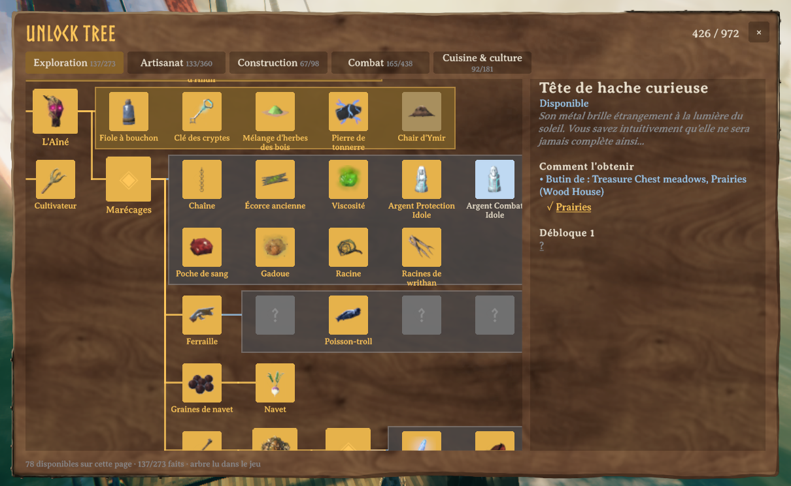

# Unlock Tree

A Minecraft-style advancement tree for **Valheim**, built from the game's real requirements: recipes,
crafting stations and their upgrades, tool tiers, creature drops, bosses and biomes. Undiscovered steps stay
hidden as **?** until you get close to them.



- **Mod**: [OkoThings/UnlockTree on Thunderstore](https://thunderstore.io/c/valheim/p/OkoThings/UnlockTree/).
  Install it with r2modman / Thunderstore Mod Manager, then open it with the inventory button or **F7**.
- **This repository** holds the mod's source (`mod/`) and **OkoSaga**, the Python tools that read the
  game's own data and build the requirement graph the mod ships as a fallback.

## Features

- Five pages: Exploration, Crafting, Building, Combat, Food & farming (a step can be on several).
- No spoilers: done and available steps are shown, everything further is a **?**.
- Details for every step: each way to get it, with amounts and ✓ for what you already have, and everything
  it unlocks. Names are clickable.
- Search across every page (accents and case ignored).
- Multiplayer aware: bosses killed by anyone in the world count, and steps your friends must have done are
  marked *done in the world*.
- The tree is built live from the running game, so it follows game updates. If that fails, the mod falls
  back to the tree shipped inside it and logs why.
- Uses the game's own icons, fonts and translations; the mod's own text is in English and French.

## Repository layout

| Path | What it is |
|---|---|
| `mod/` | The BepInEx mod (C#, net472, depends on Jötunn) |
| `mod/src/LiveBuilder.cs` | Builds the tree at runtime from ObjectDB, ZNetScene, ZoneSystem… |
| `mod/src/Window.cs` | The window: pages, tree drawing, details panel, search |
| `mod/package/` | Thunderstore manifest, README, changelog, icon |
| `extract.py`, `extract_locations.py`, `icons.py` | Read the game install (UnityPy) into JSON + icons |
| `graph.py` | Turns the extracted data into the requirement graph |
| `export_mod.py` | Exports that graph as the mod's embedded fallback tree |
| `build.py`, `template.html`, `fch.py` | Standalone HTML tree page from a character save (`.fch`) |
| `tasks/mod.md` | Roadmap |

Extracted game data and icons are not in the repository (they're the game's assets). Regenerate them from
your own install.

## Building

Needs [uv](https://docs.astral.sh/uv/), the .NET SDK, Valheim and an r2modman profile with
BepInExPack_Valheim and Jötunn (the build references the game's and the profile's DLLs).

```sh
# 1. game data (once per game update)
G=~/.local/share/Steam/steamapps/common/Valheim
uv run extract.py "$G" gamedata.json            # also writes gamedata_loc.json
uv run extract_locations.py "$G" locations.json
uv run icons.py "$G" icons                      # only for the HTML page

# 2. the mod
cd mod
./deploy.sh        # build + install into the profile (BepInEx/plugins)
./deploy.sh dev    # or: hot-reload install (BepInEx/scripts, reload with F6 via BepInEx ScriptEngine)
./pack.sh          # Thunderstore zip in mod/dist/
```

The profile defaults to r2modman's `Narnia` profile; set `PROFILE=/path/to/profile` to use another one.

## Configuration (in game)

`BepInEx/config/okothings.unlocktree.cfg`: `ToggleKey` (F7), `InventoryButtonOffset`, and `Dev.DevMode`,
which adds an **Arrange** tool to lay out the pages by hand (saved to `unlocktree.layout.json`, shipped
inside the mod by `deploy.sh` / `pack.sh`).
