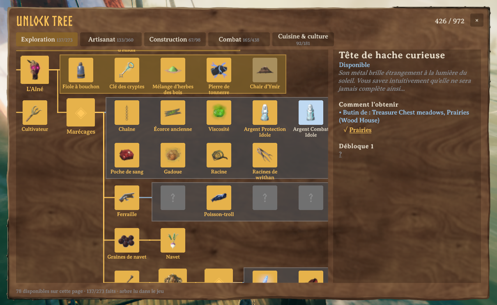

# Unlock Tree

A Minecraft-style advancement tree for Valheim. Every link is a requirement the game actually enforces:
recipe ingredients, crafting station levels, tool tiers, creature drops, boss offerings, locked doors
and the biome things are found in. Nothing is invented.

## Features

- **Five pages**: Exploration, Crafting, Building, Combat, Food & farming. A step can be on several
  pages (a sword is crafting *and* combat).
- **No spoilers**: what you've done and what you can do now are shown; everything else is a **?** that
  turns into the real thing as you progress.
- **Search**: type in the box at the top to find any step you've discovered, on any page, and jump to it.
- **Details**: click a step to see every way to get it (with amounts and ✓ for what you already have)
  and everything it unlocks. Names are clickable and jump to that step.
- **Multiplayer aware**: bosses killed by anyone in the world count, and steps that your friends must
  have done (because you own something that needs them) are marked *done in the world*.
- **Built live from the game**, so it follows game updates; falls back to a tree shipped in the mod if
  anything goes wrong (the reason is written to the BepInEx log).
- Uses the game's own icons, fonts and translations (item names in every language; the mod's own text in
  English and French).

## How to open it

- The **Unlock Tree** button in the inventory, next to Trophies / Skills.
- Or press **F7** (configurable). **Esc** closes it.

## Configuration

`BepInEx/config/okothings.unlocktree.cfg`

| Setting | Default | |
|---|---|---|
| `ToggleKey` | F7 | Open / close the window |
| `InventoryButtonOffset` | 0, 0 | Move the inventory button if it overlaps another mod's |

Client-side only: nothing to install on the server.

Source code, bug reports: https://github.com/OkoThings/UnlockTree

---

## Français

Un arbre de progression façon Minecraft pour Valheim, construit à partir des vraies conditions du jeu
(recettes, ateliers, niveaux d'outils, butins, boss, biomes). Cinq pages (Exploration, Artisanat,
Construction, Combat, Cuisine & culture), les étapes non découvertes restent des **?**, et les boss tués
par n'importe qui dans le monde comptent. Recherche intégrée pour retrouver une étape découverte. Bouton dans l'inventaire ou touche **F7**.
